  

 

  

 

<table>
<tr>
<td width="62%" valign="top">

Hi, I'm **Hamid**. I'm 17, and I love building with AI.

I don't just want to train a model. I want to build the **whole system** around it, so it runs fast, stays reliable, and really helps people.

The four things I enjoy most:

- 🧠 **Running AI in production**, from serving to testing to monitoring
- 🤖 **AI agents** that work together as a team and fix their own mistakes
- 🔎 **Smart search for AI** (RAG), so answers are accurate and come with sources
- ⚡ **Fast apps in your browser**, using WebAssembly, WebGPU and OpenGL

</td>
<td width="38%" valign="middle" align="center">

  

  

</td>
</tr>
</table>

> *"Intelligence without capability is just an idea. Capability without intelligence is just a tool. I build the bridge between them."*

 

👇 Click any card to see how I can help

 

<b>🤖&nbsp; I need a team of AI agents</b>

 

I design agents that **split big jobs into small steps**, hand work to each other, and check their own answers. This lets them handle tasks that are too large for one AI to do alone.

**Tools I use:** `Python` · `LangChain` · `PyTorch`

<b>🔎&nbsp; I need AI that answers from my own data</b>

 

I build **RAG systems**: the AI searches your documents first, then answers using what it found. You get clear answers that are grounded in real sources, not guesses.

**Tools I use:** `Python` · `LangChain` · `Hugging Face`

<b>🚀&nbsp; I need my AI to run reliably in production</b>

 

I set up the full pipeline: **serving the model, testing its quality, tracking changes, and watching it after launch**, so problems get caught early.

**Tools I use:** `Docker` · `GitHub Actions` · `Python` · `Vercel`

<b>🧠&nbsp; I need a model that is smaller, faster and cheaper</b>

 

I **fine-tune models for your domain** and make them lighter using compression ideas like quantization, pruning and distillation, so they cost less to run.

**Tools I use:** `PyTorch` · `Hugging Face` · `Scikit-Learn` · `NumPy`

<b>⚡&nbsp; I need something fast and beautiful in the browser</b>

 

I build graphics and AI that run **right on the user's device**, with no waiting for a server. That means smooth 3D scenes and instant responses.

**Tools I use:** `WebAssembly` · `WebGPU` · `OpenGL` · `Three.js` · `C++`

<b>🌐&nbsp; I need a full web or mobile app</b>

 

I build the front end, the back end and the database, and connect AI where it helps.

**Tools I use:** `React` · `Next.js` · `React Native` · `Express.js` · `TypeScript` · `MongoDB`

 

 

 

**AI and Machine Learning**

**Graphics and Browser Power**

**Languages and Frameworks**

**DevOps and Cloud**

 

 

<table align="center">
<tr>
<td align="center" width="25%"><h2>🎓</h2><b>Internships</b> Learn with great teams</td>
<td align="center" width="25%"><h2>🚀</h2><b>Founding Roles</b> Join early, build big</td>
<td align="center" width="25%"><h2>🌍</h2><b>Open Source</b> Build together in public</td>
<td align="center" width="25%"><h2>🧭</h2><b>Advice</b> Share what I've learned</td>
</tr>
</table>

 

 

**Working on something cool with AI? I'd love to hear about it.**

 

 

